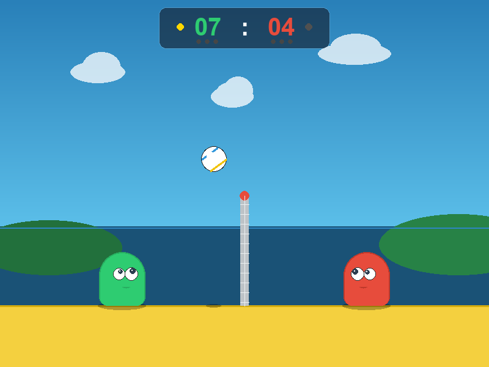

# Blobby Volley – Python Adaption

Eine leichtgewichtige, eigenständige und originalgetreue Python-Adaption des beliebten Mini-Game-Klassikers **Blobby Volley**, umgesetzt mit `pygame-ce`.



---

## Features

- **Klassische Arcade-Physik**: Elastische Kugel-Kollision an Kopf und Körper der Blobs, dynamischer Netzabprall und Schwerkraft.
- **2 Spielmodi**:
  - **1 Spieler gegen Computer**: Intelligenter, vorausschauender KI-Gegner mit 3 Schwierigkeitsgraden (*Leicht*, *Mittel*, *Schwer*).
  - **2 Spieler lokal**: Gegeneinander an einer Tastatur im direkten Duell.
- **Prozedurale Retro-Grafik**: Strandlandschaft, animierte Meereswellen, rotierender Volleyball, Schattenwurf und Blobs mit Augen, die dynamisch dem Ball folgen. Keine externen Bilddateien notwendig!
- **Prozedurale Soundeffekte**: Synthetisierte 8-Bit/Retro-Sounds für Balltreffer, Wand-/Netzabprall, Schiedsrichter-Pfiff und Jubel.
- **Vollbild- & Fenstermodus**: Beliebig umschaltbar mit `F11` bei fester Seitenverhältnis-Beibehaltung (Letterboxing).
- **Klassische Volleyball-Regeln**: Punktgewinn nur bei eigenem Aufschlag (Side-Out-Regel), max. 3 Ballkontakte pro Seite, Sieg bei 15 Punkten (mit mind. 2 Punkten Vorsprung).

---

## Steuerung

| Aktion | Spieler 1 (Grün, links) | Spieler 2 (Rot, rechts) |
|---|---|---|
| **Nach links** | `A` | `Pfeiltaste Links` |
| **Nach rechts** | `D` | `Pfeiltaste Rechts` |
| **Springen** | `W` | `Pfeiltaste Hoch` |

### Allgemeine Tasten
- `F11`: Vollbildmodus an- / ausschalten
- `ESC`: Pause / Zurück zum Hauptmenü
- `R`: Spiel neu starten

---

## Installation & Start

### Voraussetzungen
- Python 3.10 oder neuer
- `pygame-ce >= 2.5.0`

### Installation
```powershell
pip install pygame-ce
```

### Spiel starten
Direkt mit dem beiliegenden Skript:
```powershell
python run_game.py
```

Oder als Modul:
```powershell
python -m blobby_volley.main
```

---

## Tests ausführen

Die Physik und Spielregeln werden durch automatisierte Unit-Tests abgedeckt:
```powershell
python -m unittest discover -s tests
```

---

## Lizenz
Open-Source (MIT). Viel Spaß beim Spielen!
